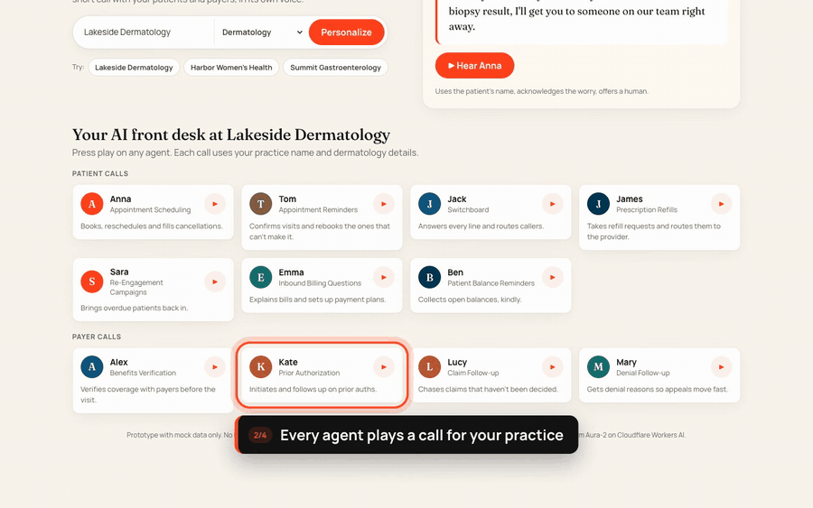

# Hear It at Your Practice

**Live:** [prosper-hear-it.pages.dev](https://prosper-hear-it.pages.dev) · **Demo video (with sound):** [watch](https://prosper-hear-it.pages.dev/demo.mp4)

Hi Prosper team, I'm Abdulsaboor, and I built this for you.

**The gap.** On your site, a potential customer can hear one agent recording, and it isn't about their practice. Competitors are moving on this: Hello Patient lets visitors talk to an agent in the browser, and Assort has a "Try it now" button. None of them tailor the demo to the visitor's own practice.

**What I built.** Enter a practice name and specialty, and every Prosper agent plays a short call for that practice in its own voice, from Anna rescheduling a skin check to Kate chasing a prior auth for a psoriasis biologic. Booking a demo carries over which agents the visitor listened to, so your team knows where to start.

**My first two weeks.** I'd polish this and A/B test it on the Use Cases page against today's experience, measuring demo-request conversion and which agents visitors play.

*Built with React, Cloudflare Pages, and Deepgram Aura-2 voices on Workers AI. Sample calls are scripted with mock data. No PHI.*
